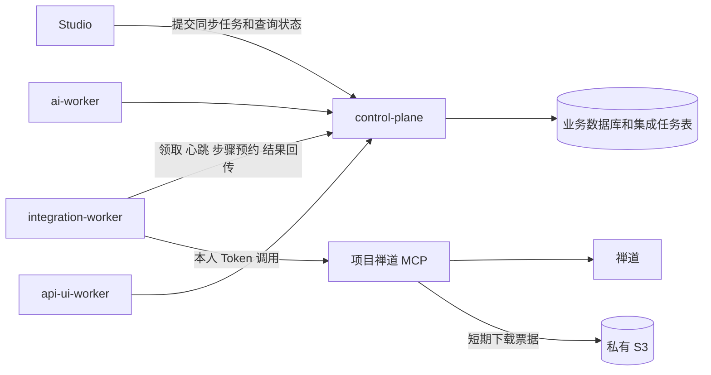

# control-plane 独立集成 Worker 拆分计划

日期：2026-10-06，更新：2026-10-07。状态：第一期 P0–P5 已在当前本地环境完成。用户授权的当前本地环境已升级至 0033，全部项目使用独立 integration-worker；全量切换任务的创建、附件及正文三个步骤均为 no-op，没有重复写入。控制面旧远端写工作流和前端同步调用已删除，旧 POST/PATCH 写入口及提示 handler 已完全删除；短只读查询和原操作核对继续保留。收尾全量回归 1162 通过、57 显式跳过；隔离 MySQL、Worker/Studio、容器及显式 180 秒专项通过。真实隔离链路、浏览器创建/上传、慢传输、恢复核对以及当前环境暂停协调源码回退已验证；未验证旧 Docker 镜像回退。示例执行开关仍默认关闭，关闭后暂停异步执行，不恢复旧写链路。当前交付及限制见[实施记录](integration-worker-implementation.md)。

第一期新增可单独部署、扩容和重启的 `integration-worker`，迁出禅道 Bug 创建、附件上传、正文图片同步，以及已关联 Bug 影响版本和指派人修改的远端执行链路。control-plane 保留浏览器入口、项目权限、个人授权、任务调度和本地业务状态。新 Worker 通过内部 HTTP 接口领取任务及回传步骤结果，不直接连接业务数据库。

这次拆分解决长时间外部调用与 Web 请求共用运行进程、发布和恢复流程的问题。它不会直接减少全部数据库查询，也不把整个外部集成业务拆成另一套后端。现有 AI Worker 和 API/UI Worker 继续独立运行；加上 Studio，仓库由四个应用增加为五个应用。

## 拆分前代码依据与实施范围

| 当前代码 | 已确认的行为 | 对拆分的约束 |
| --- | --- | --- |
| [Bug 推送 HTTP 处理](../../apps/control-plane/src/testing_agent/handlers/bug_zentao_push.py) | 请求直接等待 `pushes.push()` 返回 | 独立执行后需要异步任务入口，不能继续让浏览器等待全链路 |
| [Bug 推送工作流](../../apps/control-plane/src/testing_agent/services/bug_zentao_push.py) | 本地预约后远端校验和创建，再补传附件与正文 | 本地预约与远端执行要拆开；已关联 Bug 不可再次创建 |
| [附件同步](../../apps/control-plane/src/testing_agent/services/bug_zentao_attachment.py) | 按文件顺序执行；上传 MCP 调用超时为 180 秒 | 心跳必须独立推进；下载票据按文件临执行签发 |
| [正文同步](../../apps/control-plane/src/testing_agent/services/bug_zentao_description.py) | 校验正文基线、写入后回读；未知结果只读核对 | 不可把正文更新改成无条件覆盖或普通重试 |
| [已关联 Bug 字段修改](../../apps/control-plane/src/testing_agent/services/bug_zentao_fields.py) | PATCH 推送入口编辑影响版本和指派人，比较远端旧值，只提交变更字段，未知结果回读 | 单独迁移为字段修改任务，保留无变化不写与过期预览拒绝，不自动修改这些字段 |
| [MCP 客户端](../../apps/control-plane/src/testing_agent/services/mcp_client.py) | 区分明确拒绝与不确定写入，禁代理环境和重定向 | Worker 保留这些传输与错误分类规则 |
| [推送记录](../../apps/control-plane/src/testing_agent/models/bug_zentao_push.py)、[附件记录](../../apps/control-plane/src/testing_agent/models/bug_zentao_attachment.py) | 保存 operation ID、远端 ID、目标和各自状态 | 继续作为业务关联和同步结果的持久化来源 |
| [Worker 队列](../../apps/control-plane/src/testing_agent/models/worker_task.py) | `domain` 长度为 10，队列围绕业务 `run_id` 组织 | 不直接塞入长度为 11 的 `integration`；更关键的是现有业务运行假设不同 |
| [队列上下文](../../apps/control-plane/src/testing_agent/services/worker_context.py)、[执行授权](../../apps/control-plane/src/testing_agent/services/worker_authorization.py) | 按 AI/API/UI 解释运行，其他分支按 UI 处理 | 新集成任务使用自己的授权与上下文实现 |
| [Worker repository](../../apps/control-plane/src/testing_agent/repositories/worker_task.py) | `commit()` 隐式执行 AI 阶段持久化 | 第一期开独立任务表和 repository，避免同时重构既有三类队列 |
| [实例切换](../../apps/control-plane/src/testing_agent/services/zentao_mcp_reset.py) | 阻止进行中的推送、附件、正文写入并归档旧关联 | 新任务、写入预约和旧 operation ID 必须一起参与切换校验 |
| [项目成员变更](../../apps/control-plane/src/testing_agent/services/project.py)、[个人授权撤销](../../apps/control-plane/src/testing_agent/services/shared_service.py) | 本地权限或授权变化会使相关既有任务失效 | 新任务必须接入撤销，并按 `write` 权限校验 Bug 推送 |
| [当前生命周期 ADR](adr/0005-bug-zentao-lifecycle.md) | 本地 Bug 为 active/resolved/closed，confirmed/resolution 独立；远端状态调用仍是后续 | 本期不改变 Bug 生命周期，不把尚未实现的状态同步当作迁移范围 |

上述依据记录拆分前工作区，行号及旧同步方法属于历史参考；当前写链路位于 integration-worker，控制面对应文件保留本地命令与核对。实施前重新核对迁移 head、相关接口和新增生命周期变更，不预先占用 Alembic revision 编号。

第一期迁出以下已有远端执行：

- 创建前的远端实例、层级、影响版本和指派人复核，以及 `post_bugs`。
- 原 Bug 归属验证、`upload_bug_attachment`、远端文件结果校验。
- 原生图片链接转换、正文基线比较、`put_bugs_bugID` 和写后回读。
- 已关联 Bug 影响版本和指派人的远端旧值复核、变更字段写入与结果回读。
- 上述链路的 MCP 会话、超时分类和按步骤恢复。

第一期保留在 control-plane：

- Bug、本地处理记录、资源绑定和个人授权的管理与数据库事务。
- 推送选项等短只读查询，以及用户提交远端编号的现有只读恢复入口。附件恢复会下载内容核对，仍可能较慢，列为后续迁移候选。
- 文件访问校验、短期签名生成、本地业务状态及任务查询。
- AI、API/UI 执行队列、报告导出和现有维护任务。

禅道状态同步、反向导入、自动定时同步、GitLab 风险分析准备及全量集成查询服务化，不在第一期加入。相关需求保留独立排期。

## 部署与数据归属



新应用位于 `apps/integration-worker/`，使用独立 `pyproject.toml`、`uv.lock`、`.python-version`、Dockerfile、示例配置和 `mtx-integration-worker` 启动入口。应用 README 仅导航与启动，详细文档放在 `docs/integration-worker/`。Python 3.12 和 httpx 足以承载一期执行，不引入浏览器或模型运行依赖。

新 Worker 无公开监听端口，不接收浏览器请求，不配置数据库连接、JWT 密钥、凭据解密密钥或长期 S3 密钥。不跨应用 import control-plane 的 SQLAlchemy 模型和业务服务，也不把旧服务整类复制进 Worker；移出远端执行和纯转换实现，数据库命令留在控制面。

第一期仍使用 MySQL 任务表和拉取式领取，不增加 Redis、消息代理或独立数据库。control-plane 同时提交业务预约和任务，避免“状态已预约但派发消息丢失”的双写。真实扩容瓶颈出现后再评估消息系统。

control-plane 到 MCP 的短查询仍存在；这不是全量网络隔离。阶段目标是移走写入和文件传输长链路，并让它们拥有独立的并发限制、失败恢复和发布流程。

## 新服务项目结构与代码层级

本节的项目结构、分层职责及优化方向已确认，作为新服务实施和代码审查的约束。

实施默认沿用 control-plane 的文件夹命名、代码层级和工程约定。每个新服务在开始迁移业务代码前，先列出目录树、主要调用链、数据归属，以及与 control-plane 的结构差异；差异需要说明具体原因和验收方式。后续拆出的服务也遵循这一要求，不能各自另建一套无对应关系的项目结构。

允许的优化围绕实际职责展开：将第三方访问集中到 `gateways/`，将无 I/O 的规则提取到 `domain/`，将依赖装配和资源关闭集中到 `app.py`。Worker 用 `worker/` 承接拉取入口；没有 HTTP 或数据库职责时不建立对应目录。目录内按业务职责组织文件，不要求每层都配一套同名类，也不为保持层数添加纯转发代码。control-plane 自身的全面目录重构另行评估，不作为本次拆分的前置任务。

本期新服务及后续从 control-plane 拆出的 Python 服务，统一采用这套基础工程风格：独立应用目录与包名、src layout、main/app 分离、按职责分层、独立依赖与启动入口、统一配置生成和文档导航。具体目录随服务职责建立；提供 HTTP 的服务使用 `routers → handlers → services`，拉取式服务使用 `worker → handlers → services`。拥有独立持久化职责的服务需要另行明确数据归属与迁移方案，再建立 `models/repositories/db/alembic`，不能通过共用 control-plane 的 ORM 或数据库写入绕过拆分决策。

统一结构要求随每个新服务一起交付：

1. **工程文件独立且命名一致。** 保留 `AGENTS.md`、导航与启动用 `README.md`、`pyproject.toml`、`uv.lock`、`.python-version`、`Dockerfile`、配置示例、`src/<独立包名>/` 和 `tests/`；运行配置继续通过根管理脚本生成。新服务能单独安装、构建、启动和停止。
2. **层级按职责对应。** `main/app/core/schemas/handlers/services/repositories` 的职责与 control-plane 对应；HTTP、拉取运行、数据库和第三方访问目录按实际需要选择。`domain/` 中的规则可脱离网络与数据库执行。上述对应关系不要求每个服务都建立全部目录。
3. **业务文件便于定位。** 先按 Bug 同步、附件、正文、字段修改等实际业务职责划分文件；同一职责持续增长时，在原层内建立业务子包并提供小接口。避免将所有工作流堆进一个大 service，也避免每个函数拆成一个文件或重复创建同名模型。
4. **优化有范围和理由。** 本期落实依赖显式注入、资源集中关闭、第三方访问集中到 gateway、纯规则集中到 domain。以后新增或合并层级时，说明它承接的实际职责、依赖方向及验证方式；共享代码提取另列变更范围，优先通过版本化协议和兼容测试维持跨服务协作。
5. **结构交付可审查。** 迁移前提供拟定目录树与调用链，交付时核对实际结构，记录有意调整及原因。测试覆盖工作流、协议和故障恢复；具体文件名可以随实现调整，后文目录树用于约束职责与层级，不作为逐文件照抄的要求。

与 control-plane 现有结构的对应关系按以下规则落实，后续新服务也据此选择目录：

| control-plane 现有层级 | 新服务采用方式 | 本期 integration-worker 的具体调整 |
| --- | --- | --- |
| `main.py`、`app.py` | 保留入口与应用装配分离 | main 启动 Worker 事件循环，app 装配执行依赖并管理资源关闭 |
| `core/`、`schemas/`、`domain/` | 沿用配置、协议与纯规则的分工 | 定义新服务自己的配置和协议类型，避免跨应用导入 |
| `routers/`、`handlers/`、`services/` | 沿用入口、分派与业务编排分层 | 拉取入口放入 `worker/`，任务分派仍在 handlers，工作流仍在 services；一期无 routers |
| `repositories/`、`models/`、`db/`、`alembic/` | 按实际数据归属配置持久化层 | repository 通过控制面 HTTP 访问任务；业务 ORM、数据库会话和迁移继续归控制面 |
| services 中的第三方调用 | 在新服务中集中到 `gateways/` | MCP 传输与禅道工具映射独立于业务工作流 |
| 配置、依赖、容器、测试及文档入口 | 保留每个应用独立运行的工程文件 | 使用独立包名、锁文件、Dockerfile 和启动命令，运行配置仍由根管理脚本生成 |

新应用沿用 control-plane 的 src 布局、入口与装配分离、配置目录及分层命名。结合拉取式 Worker 的实际职责，使用 `worker` 作为入口运行层，保留 `handlers/services/repositories/domain/schemas/core`；增加 `gateways` 表达第三方 MCP 访问。以下为一期拟定目录，实施时只建立有实际代码的文件，不创建占位目录。

```text
apps/integration-worker/
├── AGENTS.md
├── README.md
├── pyproject.toml
├── uv.lock
├── .python-version
├── Dockerfile
├── .dockerignore
├── .gitignore
├── config/
│   └── local.example.toml
├── src/
│   └── testing_agent_integration_worker/
│       ├── __init__.py
│       ├── main.py
│       ├── app.py
│       ├── core/
│       │   ├── config.py
│       │   ├── errors.py
│       │   └── logging.py
│       ├── schemas/
│       │   ├── job.py
│       │   └── step.py
│       ├── domain/
│       │   ├── execution.py
│       │   ├── bug_fields.py
│       │   └── bug_description.py
│       ├── worker/
│       │   ├── poller.py
│       │   ├── lease.py
│       │   └── lifecycle.py
│       ├── handlers/
│       │   └── jobs.py
│       ├── services/
│       │   ├── bug_sync.py
│       │   ├── attachment.py
│       │   ├── description.py
│       │   ├── fields_update.py
│       │   └── step_execution.py
│       ├── repositories/
│       │   ├── control_plane.py
│       │   └── evidence.py
│       └── gateways/
│           ├── mcp.py
│           └── zentao.py
└── tests/
    ├── conftest.py
    ├── test_config.py
    ├── test_worker_lease.py
    ├── test_worker_protocol.py
    ├── test_bug_sync.py
    ├── test_bug_fields_update.py
    └── integration/
        └── test_sync_recovery.py
```

`config/local.toml` 是由管理脚本生成且被忽略的运行文件。新包名固定为 `testing_agent_integration_worker`，console entry 为 `mtx-integration-worker = testing_agent_integration_worker.main:main`，避免与 control-plane 的 `testing_agent` 包混名。示例与生成配置路径统一采用 control-plane 的命名；`scripts/manage.py` 同步登记模板、local 输出及 Docker 挂载 `/app/config/local.toml`，并为新服务注入自己的 APP_CONF。详细文档继续放在 `docs/integration-worker/`，应用 README 只导航和启动。

| 层级 | 职责 | 允许的依赖 |
| --- | --- | --- |
| `main.py` | 解析 CLI、加载配置、调用应用工厂、启动事件循环或执行本地 healthcheck | app/core；不装配各个业务任务 |
| `app.py` | 创建并注入控制面 repository、MCP gateway、任务工作流和 Worker runtime；统一管理资源关闭 | 各层，仅作为装配入口 |
| `worker/` | 领取、轮询退避、租约续期、执行槽、SIGTERM 排空和健康信息 | handlers、租约所需 repository、core、schemas/domain；不调用 MCP 写入 |
| `handlers/jobs.py` | 根据 task type/version 分派两个任务类型，统一进入工作流并整理执行结论 | services、schemas/domain；不实现远端步骤和重试循环 |
| `services/` | Bug 同步、单文件上传、正文更新、字段修改及统一步骤执行；使用授权许可和结果回执 | repositories、gateways、domain、schemas/core；不反向依赖 handler/worker |
| `repositories/control_plane.py` | 控制面任务状态与授权材料的 HTTP Adapter：claim/input/access/heartbeat/prepare/result/evidence/completed，解析回执和错误 | schemas/domain/core；不包含 Bug 同步工作流 |
| `repositories/evidence.py` | 原子保存和读取待回传的安全结果证据，回执确认后清理对应记录 | schemas/domain/core；不领取任务、不调用 MCP，不保存凭据或承担业务状态裁决 |
| `gateways/` | MCP 协议/会话/错误分类及禅道工具映射，完成一次远端操作或只读复核 | schemas/domain/core；不自动重试不确定写入，不控制任务状态 |
| `domain/` | 执行上下文与结果值对象、字段差异比较、正文规范化和原生图片链接转换等纯规则 | 标准库及必要的纯计算库；不做 HTTP、配置读取或数据库操作 |
| `schemas/` | 控制面 HTTP 请求/响应与回执校验，明确协议字段和版本 | core 中无运行状态的常量/错误；不引用 ORM 或工作流 |
| `core/` | 配置校验、日志脱敏、异常类型等基础能力 | 标准库和基础依赖；不依赖业务服务 |

主要调用链为：

```text
worker/poller
  → handlers/jobs
    → services/bug_sync 或 services/fields_update
      → services/step_execution
        → repositories/control_plane：预约、授权、记录步骤结果
        → gateways/zentao → gateways/mcp：远端复核与一次写入
      → domain：纯转换和比较
```

Worker 的 repository 表示“通过控制面访问持久化任务状态”，不是本地 ORM。数据库实体、SQLAlchemy repository、会话与 Alembic 仍在 control-plane 按其原有目录组织。新应用一期不建立 `db/models/alembic`；不提供入站 HTTP，因此不建立 `routers/api`。未来存在真实入站需求时，再增加 `routers → handlers`，复用已有工作流，不把业务逻辑重新写到路由层。

本地 `evidence` 文件仅作为结果回传的恢复证据：保存原 job/step/operation/event 身份及安全结果，由步骤执行入口负责回传，不能据此重新执行远端写入。它不改变业务数据归属，也不要求引入数据库依赖；留存、卷恢复和数据库恢复后的隔离规则按本计划对应章节实施。

与现有结构相比，采用以下具体优化：

1. **所有装配集中在 app.py。** `create_worker(settings, ...)` 显式接收配置及可替换依赖；服务构造函数不通过另一个服务取得 session/client，不在导入模块时创建网络客户端、读取配置或启动后台任务。控制面 HTTP Adapter 可以按进程管理，MCP gateway 通过工厂按任务及当前授权建立会话，不跨用户共享 Token、认证头或 MCP session ID。配置与入口生命周期有实际含义，app.py 无须引入 FastAPI/uvicorn。
2. **一步执行拥有一个明确入口。** `step_execution` 收拢一次步骤的预约、许可到期检查、错误分类和幂等结果回传；每种工作流只描述步骤顺序和专有规则。轮询退避、控制面网络重试、MCP 写入失败分别由所属层处理，避免多层重试叠加。纯只读调用的有限重试和写入不确定性的区分必须保留。
3. **协议模型与内部值对象按实际差异分开。** schemas 用 Pydantic 校验远端数据；domain 只为存在额外不变量或行为的执行上下文/结果定义类型。简单字段不在每层重复复制，也不把业务决策放进 Pydantic validator；Token/票据字段禁止 repr 和日志输出。
4. **外部访问集中在 gateway。** 工作流不直接构造 httpx 请求，不调用其他服务私有方法；MCP JSON-RPC、SSE 和 uncertain 分类在一个传输实现中维护，禅道工具名与原始响应转换集中在 zentao gateway。control-plane 保留它实际需要的查询客户端，双方通过协议 fixture 验证兼容，不跨应用 import。
5. **维持轻量分层。** handlers 负责真实任务分派，repository 直接作为 HTTP Adapter；不再在外面增加同名 client/service 的逐方法转发。接口只为实际的 HTTP/测试 Adapter 替换需要建立，暂不建设通用插件系统、通用 Repository 基类或另一套共享运行框架。

基础工程约定跟随 control-plane：Python 3.12、uv/独立锁文件、src layout、在 pyproject 中使用 uv_build、开发依赖通过 `--extra dev` 安装、pytest/pytest-asyncio、Ruff 100 字符及对应 lint 规则、mypy。只添加新服务实际使用的运行依赖，例如 httpx 和 Pydantic；不因目录相似引入 SQLAlchemy、Alembic、FastAPI、Casbin 或 reportlab。配置优先级采用 CLI `--config/-c` → APP_CONF → `config/local.toml`，缺少内部令牌、控制面地址或配置不合法时启动失败，避免静默使用占位凭据。

上述职责和依赖方向在 P0 固化到新项目开发指引；P2 按此结构交付。测试重点是纯规则、公开工作流接口、真实 HTTP 协议和故障恢复，不为目录中的每一个转发方法重复建立单元测试。一次工作流通过公开接口、真实控制面 fixture 和隔离 MCP fixture 覆盖从领取到结果恢复的行为。

P2 结构验收需提交以下可核对证据，不能只检查目录名称：

| 检查项 | 验收方式 |
| --- | --- |
| 独立运行 | 使用新应用自己的依赖文件、锁文件、Dockerfile 和入口完成安装、构建、启动及停止；运行时不依赖 control-plane 源码目录 |
| 调用链与依赖方向 | 分别追踪 Bug 同步和字段修改工作流，确认 runtime 通过 handler 进入 service，HTTP/MCP 访问集中在 repository/gateway，service 不反向导入 worker/handler |
| 装配与资源生命周期 | 配置、依赖创建和关闭路径可定位到 main/app；导入 domain/schema/service 模块不会读取运行配置、建立网络连接或启动后台任务 |
| 业务规则可独立验证 | 字段比较、正文转换等纯规则可脱离 HTTP 和数据库执行；工作流通过注入依赖完成协议和恢复验证 |
| 分层有实际职责 | 各层包含本层规则或 Adapter 行为；删除无实际用途的占位目录、逐方法转发和重复模型，不以目录齐全作为交付标准 |
| 与 control-plane 工程规范对应 | 按上表核对沿用和调整的层级；所有差异能由服务入口、数据归属或外部访问职责解释，本地恢复证据不能成为第二套业务状态来源 |

## 新任务表与已有同步记录

新增任务、步骤及最小领取回执表，迁移由 control-plane 的 Alembic 管理。实现协议时补充了独立领取回执：空领取和历次领取代次都需保留原响应，不能仅在任务上覆盖当前 claim request ID。它属于本地传输幂等记录，不增加业务数据库或队列服务。

| 表 | 关键字段与约束 | 职责 |
| --- | --- | --- |
| `integration_jobs` | job ID、protocol version、task type、project/bug/actor/service/connection ID、目标与输入快照、预期步骤清单、request ID 和请求摘要、状态、worker ID、claim request ID、claim generation、租约、时间、结果摘要 | 调度、身份、冻结输入及任务整体进度 |
| `integration_job_steps` | step ID、job ID、step key、operation ID、prepare request ID、执行类型、输入摘要、状态、许可到期时间、远端结果摘要、回传事件 ID/摘要及最小回执集合 | 持久化远端操作的预约、写入意图和幂等回传证据 |
| `integration_claim_receipts` | worker/request 的摘要主键、请求内容摘要、可空 job ID、无敏感材料的领取响应、创建时间 | 空领取与历次领取响应的持久化幂等，不因任务重新领取覆盖旧回执 |

任务类型一期为 `zentao_bug_sync` 和 `zentao_bug_fields_update`。前者步骤为 `create_bug`、`upload_attachment:<fileId>`、`update_description`；已经有关联的 Bug 跳过创建。后者只有 `update_fields`，冻结用户指定的新值与 expectedRemoteBugId、expectedOpenedBuild、expectedAssignedTo。两个任务类型共享同一 Bug 的活跃写入执行权，不把字段修改隐式并入补传。

任务表承担调度状态，步骤表承担远端调用执行记录。`bug_zentao_pushes` 和 `bug_zentao_attachments` 继续承担关联及领域结果，字段修改继续映射到原 `payload_json._fieldUpdate` 记录。步骤结果与对应领域记录由控制面同一事务更新，不让 Worker 分别回写两套状态。

具体约束：

- 请求幂等键按发起人和 request ID 唯一；同键不同请求摘要返回冲突。前端在同一次提交网络重试中复用 request ID。
- 同一 Bug 只允许一个活跃写入任务。使用可空的唯一 active scope key 竞争执行权，终态释放；不同 Bug 可以并发。
- 相同发起人的重复请求返回已有任务；其他成员的并发发起返回冲突，不悄悄改用前一个成员的凭据。
- 领取先读取有界候选主键，再对主键行使用 `SKIP LOCKED`，同时更新 worker ID、claim generation 和租约。避免 MySQL 队列索引范围锁阻塞其他领取者更新状态；旧领取者不能操作新领取的任务。
- 步骤键在一个任务内唯一，回传事件 ID 幂等。已成功的文件和远端 Bug 复用既有映射。
- 持久化输入冻结实际正文 HTML、创建 payload、本次文件清单与文件元数据、绑定身份和目标快照；字段任务另冻结 before/desired。内容摘要用于变化校验，不替代实际执行输入。Worker 不临时读取最新正文拼接同一个旧任务。不保存 Token、签名 URL、认证头或完整 MCP 原始错误响应。
- 保持任务恢复所需的最小历史。Bug 或项目删除前处理任务与写入意图；任务表资源引用不形成新的删除死锁。删除后的迟到证据仅归档原任务，不重建已删除业务资源。留存与清理规则随迁移定义，并保护未核对步骤。

预期步骤清单在提交时生成，记录条件跳过规则与依赖，不在 Worker 随机补出新步骤。创建结果决定后续步骤使用的 remoteBugId；正文更新依赖它实际引用的图片文件映射全部成功，独立附件失败可形成 partial。无变化的字段修改或无需正文更新也须明确落成 no-op/skipped 结果，不能缺少记录就假定完成。

P1 的索引至少覆盖待领取任务的状态/创建顺序、租约到期扫描、按项目/Bug 查询最新任务，以及步骤 job ID/step key 唯一查询。领取只扫描支持的 protocol version 和 task type，并跳过正在受目标并发限制的任务；不先占租约再等待实例内限流。跨副本的并发限制按实际禅道实例身份协调，不能仅按 MCP 端点限流而让同实例的多个端点绕过。

任务状态建议为 `queued/claimed/running/succeeded/partial/failed/unknown/canceled`，与现有 Bug 创建、附件、正文状态分开。`partial` 表示部分明确完成；`unknown` 表示存在不确定的外部操作。不能因为 Bug 创建 succeeded 就把整个任务判为 succeeded。

归并规则在 P0 固化：有未决写入先判 unknown；仍有可执行步骤保持运行；所有必要步骤明确成功或确认无需执行才判 succeeded。部分成功但有明确失败/依赖阻塞判 partial；无成功且明确失败判 failed。主动撤销保留 canceled 与已完成步骤摘要，不能掩盖未决写入。前置失败/撤销时明确标记未执行步骤的原因，不能将它们当作普通 skipped 后判整体成功。

## 浏览器接口与交互

新增异步入口：

| 接口 | 行为 |
| --- | --- |
| `POST /v1/bugs/{bugId}/zentao-sync-jobs` | 校验当前写权限、本人授权、本地目标与快照；预约活跃任务并返回 202、jobId、jobStatus、领域状态摘要 |
| `POST /v1/bugs/{bugId}/zentao-field-update-jobs` | 校验本人权限和原关联，冻结用户选择与预览旧值，接受独立字段修改任务；返回 202 |
| `GET /v1/bugs/{bugId}/zentao-jobs/{jobId}` | 按 Bug 读取权限返回两种任务及整体结果；不返回个人凭据 |
| 现有 `GET /v1/bugs/{bugId}/zentao-push` | 保留已有领域字段，增加 activeJob、latestJob 摘要和执行方式；worker 模式的轮询路径只读本地状态 |
| 现有 options 和 reconcile | 保留不写远端的候选/核对语义；本地恢复提交时检查活跃 job/step/operation，同事务同步对应步骤和任务摘要 |

提交阶段不访问远端 MCP，不等待完整执行。`expectedTarget` 校验本地目标；远端失效的影响版本或指派人由 Worker 在写前再次验证，并作为任务失败返回。HTTP 202 只表示已接受。

worker 模式下 ready 表示本地关联、当前写权限和本人授权满足提交条件，实际远端可用性由执行时复核。queued 不把旧 preparing 的 5/6 分钟超时规则当作失败；执行中状态由任务租约和步骤写入意图推导。查询保留 latestJob，保证活跃任务结束后、页面重新打开仍能看到整体失败或 partial。job 查询仅返回 Bug 权限允许的摘要，不向只读或开发成员暴露冻结请求、授权连接详情和 Worker 内部材料。

Studio 已有每 3 秒轮询 preparing/creating、附件或正文 syncing，以及字段 preparing/updating 的实现。扩展为同时轮询 queued/claimed/running，提交提示改为“已提交”，终态才按 succeeded/partial/failed/unknown 展示结果并刷新 Bug 动态。页面重开可通过现有状态入口发现未完成任务；查询网络错误不改变任务结果。

首次创建继续显示影响版本和指派人弹窗，补传继续沿用既有远端值。独立字段编辑显示远端当前值；只提交有变化的字段，保留“无变化不写”“过期旧值不覆盖”“未修改的旧版本无需重新选有效候选”的行为。其他成员可按权限查看任务结果；重试以本次主动操作人的本人授权创建新任务，绝不自动借用原发起人凭据。

不把现有同步 POST/PATCH 无声改成异步成功。灰度项目通过新入口执行；旧客户端在这些项目调用旧同步 POST/PATCH 时得到明确的迁移提示和冲突响应，避免第二个写入入口。非灰度项目暂时沿用旧实现。两种方式必须经过同一活跃任务检查及既有预约条件更新，实例和 Bug 级别不允许双执行。

两个现有 reconcile 入口虽然不写远端，却会改变本地关联或文件映射。它们在远端只读核对后重新锁定并校验原 operation 与当前执行权，禁止与正在执行的创建、上传、正文或字段修改相撞；只应用与原未知步骤对应的恢复证据，不以用户提交的编号改掉新任务目标。

字段 options GET 也并非无本地副作用：当前 `BugZentaoFieldsService.options()` 会在远端回读等于 unknown 操作 desired 时，通过 `recover()` 更新本地同步状态和动态。保留该入口时，同样接入原步骤和 operation 的受限核对事务；不能绕过任务协调器悄悄写状态，也不能因为请求方法是 GET 就假定无需并发保护。

## Worker 内部协议

以下为新增接口草案，统一在 `/internal/integration-worker` 下，使用专属 Worker 凭据和 protocol version。

| 接口 | 作用 |
| --- | --- |
| `POST /jobs/claim` | 返回一个可领取任务、claim generation 和租约，或空任务 |
| `GET /jobs/{jobId}/input` | 返回冻结输入、已有同步映射及 input/target revision；校验当前领取身份 |
| `POST /jobs/{jobId}/access` | 为该任务的当前发起人获取实时 MCP 地址和 Token及 access revision，仅允许任务绑定服务；返回 no-store |
| `POST /jobs/{jobId}/heartbeat` | 校验领取身份并按服务器时间续租 |
| `POST /jobs/{jobId}/steps/{stepKey}/prepare` | 接收 Worker 前次复核的 input/target/access revision 与操作输入摘要，逐项比较当前值；提交 operation ID 与写入意图，返回本次允许的操作及实时访问材料 |
| `POST /jobs/{jobId}/steps/{stepKey}/preflight-failure` | 写前只读验证失败时保存幂等失败事件；仅允许尚无写入意图的步骤，不能以客户端布尔值清除未知写入 |
| `POST /jobs/{jobId}/steps/{stepKey}/result` | 幂等接收明确成功、明确失败或未知结果，同事务更新步骤与领域记录 |
| `POST /jobs/{jobId}/steps/{stepKey}/evidence` | 受限接收旧领取者针对已存在写入意图的晚到结果证据，不发放凭据、不新授写入权 |
| `POST /jobs/{jobId}/completed` | 汇总持久化步骤结果，计算整体结果；不信任 Worker 仅提交的 success 布尔值 |

所有新操作接口绑定 job ID、worker ID、claim generation，步骤接口另绑定 step/operation ID。跨任务、跨 Bug 或旧 operation ID 普通写回拒绝。已经接受的 result 回执，以及旧操作 evidence 的校验顺序与适用条件见下一节，不能笼统使用“当前租约有效”拒绝所有历史事实。

远端执行的顺序是：读取输入 → 获取当前访问材料 → 远端只读复核 → 最后调用 prepare → 得到授权且写入意图已落库 → 执行一次远端写入 → 回传结果。

revision 是控制面生成的不透明版本标识，分别记录源输入、绑定/目标、授权和执行派生映射，不直接把共享 ORM updated_at 当作一个全局版本。Worker 将此前 input/access 返回的标识原样带入 prepare，不能仅取得一套新凭据就沿用旧复核。prepare 发现本地正文、文件、目标、端点或本人授权相对复核上下文发生变化时停止执行；不要把前一次复核结果应用到新配置。

创建成功、上传成功本身会改变远端 ID、文件映射和领域记录时间。这些是任务允许的派生变化，不应让后续 prepare 因“版本变了”拒绝本任务。result 回执返回新的派生映射版本和实际远端 ID；Worker 进入下一步前重新取得输入视图的执行上下文，冻结源内容仍保持原值。每步输入另存实际远端目标和文件映射摘要，以便失败后核对。

当前附件链路把 S3 下载 URL 传给 MCP，由 MCP 下载并上传禅道。继续采用此方式：控制面在当前文件步骤 prepare 时校验归属并签发短时票据，Worker 不取得 S3 密钥。签名有效期需覆盖工具传输时限和合理余量，不能在任务排队时批量签发全部文件票据。

每次外部写前由控制面校验 `write`，而非沿用现有 AI/API/UI 领取时的普通项目 read 检查。个人 Token 只存在 Worker 内存，结果回传过滤认证信息、下载票据和敏感原始响应。

## 协议重试与完成闭环

| 操作 | 幂等和恢复规则 |
| --- | --- |
| claim | Worker 每次新领取使用 claimRequestId；响应丢失时用同一键取回原领取，不再领取第二个任务。控制面在任务行持久化该键，一个执行槽只能拥有一个未解决领取。收到明确空响应后才生成下一次键；空响应丢失可用原键重试，只要该键已登记任务就返回原领取 |
| prepare | 为具体步骤/领取/输入保存 request ID 和预约回执，最多建立一个写入意图；重复请求不得生成新 operation ID。只有收到本次有效许可且尚未执行过它的进程才可发起一次 MCP 写入；响应丢失或进程重启后的历史预约不构成新写许可 |
| result | 回传使用冻结的 event ID 和内容摘要。身份范围校验后先查已有回执：同键同内容返回原结果，即使租约已结束；同键不同内容返回冲突。新事件再检查领取/operation。重复结果不重复追加 Bug 动态，不把已成功终态降回 failed/unknown |
| evidence | 只能对应已经持久化的原 job/step/claim/operation/目标。保存最小证据；原操作仍是当前 unknown 且关联未变时可以核对完成，否则只归档。不能覆盖新实例或新步骤，不能借此访问 Token 或执行下一步 |
| completed | 只是显式汇总确认，不是唯一完成开关；重试返回相同结果。最后步骤结果事务即可据预期步骤清单归并任务终态、释放执行权、写一次动态。Worker 在最后 result 后退出或 completed 响应丢失，任务也能完成 |
| 查询和清理 | 清理器按预期步骤清单补做幂等归并；不因所有远端结果已明确但缺 completed，就标 unknown 或重派。缺必要结果时才按具体写入意图区分只读恢复与 unknown |

回执是无敏感访问材料的持久化响应，不能用持久化 prepare 回执缓存 Token 或签名。已经过期的 prepare 查询只返回预约事实和恢复指引，不重新下发旧写许可。对明确未发起写入的失败，需要在同一领取下记录可验证的前置失败；有疑问时保留 unknown，不能通过事后客户端布尔值强行解锁。

个人授权撤销或任务撤销后，读取旧结果回执/提交 evidence 与申请新写入许可是不同权限路径。前两者仍验证集成服务令牌与原操作身份，只能处理历史事实；后者必须具有当前用户写权限、当前授权和有效租约。

## 超时 撤销与恢复

Worker 服务专用令牌和任务发起人的个人 MCP Token 是两种身份。前者只允许调用集成 Worker 内部路由，后者只属于该任务发起人。新的内部验证器不接受现有 AI/API/UI 公共令牌，也不能提供任意 connection ID 解密接口。

| 情况 | 必须执行的恢复规则 |
| --- | --- |
| 没有未决写入意图，租约丢失 | 已明确完成的步骤保留；可归并终态或重新领取剩余安全步骤，递增 claim generation，重新校验权限和输入，不重做成功写入 |
| create/upload/update 已有写入意图，结果缺失 | 对应步骤记 unknown，不因租约过期重新执行该写入 |
| 禅道明确拒绝或已证明写入未发生 | 记 failed；由新手动任务恢复允许重试的步骤 |
| 远端成功，控制面结果响应丢失 | Worker 重试同一个 result 事件；不重发 MCP 写入 |
| 进程在远端成功后、回传前崩溃 | 保留写入意图，进入核对；没有远端幂等能力时不声称能做到 exactly once |
| 旧 Worker 迟到回传 | 普通回写必须符合当前 claim/operation；同一旧操作的晚到证据可归档或完成原 unknown 核对，不覆盖新关联和新尝试 |
| 本人授权撤销或项目写权限丢失 | 停止领取、访问材料发放和后续步骤；已发出的远端请求不能被事后撤销，仍接收受限结果证据 |
| 项目或服务实例切换 | 锁定项目并处理活跃任务；已在写入中的操作阻止切换，旧任务永久失效；未知结果按既有显式核对/归档规则处理 |
| 本地正文或附件变更 | 写前版本不符时停止该步骤；已成功文件保持映射，新的手动任务补齐新内容 |
| 影响版本或指派人的远端当前值与用户预览不同 | 字段修改停止并要求重新加载；unknown 更新仅回读，不能重复 PUT |

unknown 只禁止不确定步骤的盲目重写；已经确定成功的 Bug 和文件不重建。其他明确安全的补传可由新任务按领域记录计算恢复计划。创建本身 unknown 时不允许创建或依赖未确定 Bug ID 的后续写入。正文 unknown 继续回读核对，并保留当前代码已证明旧图片编码失败后的受限修复规则。

所有者/成员降为只读或开发成员时，集成任务失去 write，必须失效。现有 AI/API/UI 队列对普通成员降为只读成员有不同历史语义，不因这次接入顺便改变它。

撤销挂接点包括成员角色变化、成员移除、用户删除、共享服务授权撤销/删除、个人连接删除、实例确认切换及关联清理。已发放的 Token 和已经在途的请求有不可消除的竞争窗口；逐步骤授权复核、阻止继续发起和记录结果是本期可保证的行为。

租约与远端调用时限独立。建议初始轮询 2 秒、心跳 10 秒、租约 60 秒、每实例一个任务并发、每 Bug 单任务串行；这是可调初始值，需用 180 秒附件调用的故障试验验证。心跳运行在独立异步任务中，不能被文件传输或同步 CPU 工作阻塞。租约清理由控制面执行有界扫描，不增加第二个维护服务。

续租失败会通知执行协程，不能只记录日志后继续下一次远端写入。Worker 根据服务器返回的租约剩余时间和本地单调时钟建立带余量的截止时间；prepare 的许可期限不超过当前租约。超过截止、收到拒绝或 SIGTERM 时停止取得新许可、停止开始新步骤；已经发出的请求保留结果/未知证据，不因中断取消就认定远端没有写入。

unknown 任务释放普通 active scope 后，原不确定步骤仍持有领域层的重写门禁；新任务 prepare 会查询历史 write_intent/unknown 与旧领域记录，不仅检查“是否有活跃 job”。instance/service 切换、删除、人工核对与新写入遵循统一项目 → 活跃执行权 → 领域记录 → 步骤记录的加锁顺序，远端 I/O 不占数据库事务。锁死重试只能重试本地事务，不能自动重试已发出的 MCP 写入。

同一禅道实例内更换 MCP 服务/端点也必须处理旧任务，而不只处理 instanceUrl 变化。[现有项目绑定更新](../../apps/control-plane/src/testing_agent/services/resource_binding.py)和[同实例换传输测试](../../apps/control-plane/tests/test_bug_zentao_push_api.py)表明这条路径存在：保留已成功远端 Bug ID，失效旧 endpoint/授权复核上下文，拒绝未解决写入的迁移；不能让冻结了旧 service ID 的 Worker 在切换后继续执行。

## 代码变更清单

| 位置 | 拟变更 |
| --- | --- |
| `apps/control-plane/src/testing_agent/models/` 和 `repositories/` | 新增 integration job/step 模型及专用任务 repository，不走 AI persist |
| `apps/control-plane/alembic/versions/` | 新增表、索引和唯一约束；升级、降级与当前模型对照测试 |
| `services/integration_job.py`、`services/integration_step.py`、`services/integration_authorization.py` | 新增派发、租约、步骤事务、凭据和输入复核；名称为拟定 |
| `services/bug_zentao_push.py` | 拆出本地目标、预约和结果更新；worker 模式停止直接执行远端写入 |
| `services/bug_zentao_attachment.py`、`bug_zentao_description.py`、`bug_zentao_fields.py` | 保留本地记录/摘要/预约职责；将上传、远端基线比较、图片转换、字段更新及写回读迁出 |
| `services/project.py`、`auth.py`、`shared_service.py`、`integration_connection.py`、`zentao_mcp_authorization.py`、`zentao_mcp_reset.py`、删除逻辑 | 接入集成任务撤销、执行中保护和迟到回传保护 |
| `routers/bugs.py`、`handlers/bug_zentao_push.py`、相关 schemas | 新异步入口及现有查询的活跃任务摘要 |
| `routers/integration_worker.py`、`handlers/integration_worker.py`、`app.py`、`api/deps.py` | 新内部协议、专属认证与依赖装配 |
| `core/config.py`、控制面配置示例 | 集成专属令牌、执行方式开关及灰度项目配置 |
| `apps/integration-worker/` | 按上文 control-plane 风格的目录与依赖规则交付 main/app、core/schemas/domain、worker/handlers/services/repositories/gateways 及测试 |
| Studio Bug API/types/推送面板 | 异步入口、提交幂等键、队列状态轮询、终态提示与动态刷新 |
| `config/platform.example.toml`、`scripts/manage.py`、根 Compose、外部数据库覆盖、根编排测试 | 配置生成、独立构建/启动、容器依赖和实例扩容 |
| `docs/control-plane/`、`docs/integration-worker/`、`docs/studio/`、`docs/deployment.md`、导航和根 AGENTS | 记录新职责和协议、异步行为、运维与五应用结构 |

现有四应用的依赖文件、锁文件、Dockerfile 和启动入口分别保留。只为实际改变的依赖更新对应锁文件。

## 实施批次与发布顺序

| 批次 | 可审查交付物 | 验收和发布条件 |
| --- | --- | --- |
| P0 规范与基线 | 新 ADR 草案、任务/步骤状态表、请求/回传 schema、失败矩阵、当前相关行为测试基线、新服务目录和分层指引 | 对齐 ADR 0005；确认与 control-plane 对应的目录树、调用链、数据归属及结构差异理由；明确现有 unknown 与图片修复语义；不改变线上执行 |
| P1 数据与本地命令 | 加法数据库迁移、任务/步骤 repository、本地预约与结果命令、查询和撤销逻辑；最小执行开关及配置生成 | 同事务入队；并发去重；撤销；新旧关联记录兼容；功能开关关闭 |
| P2 独立 Worker | 按已确认目录与分层约定交付完整新应用、内部协议、专属认证及令牌/运行配置生成、Compose/独立启动、MCP 执行、心跳和按步骤回传 | 对照 P0 目录和差异说明完成职责、依赖方向及资源生命周期审查；删除无实际职责的占位目录和纯转发层；无数据库/长期 S3 密钥；两个实例正确领取；崩溃与迟到回传试验；真实协议隔离 fixture |
| P3 前端与灰度 | 新异步入口、队列状态、提交幂等、终态动态刷新；完整导航及运维接入 | 仅允许指定项目走 Worker；旧 POST/PATCH 防止双执行；返回 202 后页面能恢复查询 |
| P4 恢复验收与切换 | 验证真实禅道、S3、网络与权限；按项目扩大启用；记录实际基线对比 | 创建/图片/附件可查看；unknown 不重复写；停止 Worker 不阻塞普通 Bug/资产接口；发布及回滚演练通过 |
| P5 收尾 | 删除迁完调用者的旧同步写入路径及临时转发，更新职责和运维文档 | 全量项目已切换、旧活跃预约处理完成；留下短只读和核对功能；再次完整回归 |

P1、P2 的协议与存储稳定后再进入 P3；不能只创建一个 Worker 项目就切换浏览器请求。每批可以形成独立 PR。第一期六批完成后，报告或其他集成迁移另立计划。

各阶段的配置状态、发布生效方式、按项目扩大范围、暂停与回退步骤，以及 P5 旧路径移除前提，统一执行[灰度与回退流程](../integration-worker/rollout.md)。验收记录分别注明配置/进程演练和实际镜像回退，不能将暂停开关的结果当作旧版本兼容证明。

发布顺序：备份 → 应用加法迁移 → 部署支持新协议但开关关闭的控制面 → 部署新 Worker → 部署能识别异步模式的 Studio → 启用灰度项目。部署 Worker 本身不自动迁移旧 `creating/uploading/syncing/unknown` 操作，也不扫描旧记录重新创建；先核对和完成已有操作。

启用灰度前，所有接收业务流量的控制面实例都必须具备同一执行权协调器和旧 POST/PATCH 门控；尚未升级的实例不能继续留在请求池中执行旧同步写入。先等待旧调用排空或按 operation 核对，再启用 Worker 写入。Worker claim 声明支持的 protocol version/task types，控制面只派发相交能力；版本不兼容时保留 queued 并显示执行能力不足，不让旧 Worker 领取后误判未知任务为 failed。滚动升级先确保控制面兼容仍在线的 Worker，再升级 Worker，最后启用新协议任务。

回滚先暂停新提交，停止新领取，等待或核对正在写入的步骤，保留现有任务和结果表，再切回已确认无活跃写入的项目。配置关闭 Worker 不代表任务已经取消。通常保留加法数据库迁移，避免删除恢复证据；有未知结果时禁止把请求直接切回旧同步路径。最终删掉旧执行路径后的回滚需恢复兼容协调实现，保持提交和领取暂停；不恢复旧同步写入，不删除执行证据。

## 配置 部署与观测

配置来源继续是 `config/platform.example.toml` 与本地忽略的 `config/platform.toml`，所有运行配置由 `scripts/manage.py` 生成。建议增加 `shared.integration_worker_token`、`control_plane.integration_execution` 和 `integration_worker.worker` 配置；令牌默认初始化随机生成，旧配置缺项的升级过程明确补齐新字段，不轮换已有密钥。[当前 init](../../scripts/manage.py#L91)遇到已有 platform.toml 直接返回，不能要求老部署“再跑一次 init”便宣称完成升级；P1/P2 需交付显式、幂等的缺项补齐操作，同时保留自定义配置和文件权限。新令牌不得与旧共享 Worker 令牌相同，校验器拒绝冲突配置。

管理脚本增加新应用项目映射、示例到运行配置的生成、本地启动命令与 Docker 模式 URL。Compose 中新增无公开端口的 integration-worker，依赖控制面健康；保留内置/外部数据库两种模式和迁移启动条件。不同实例自动生成含主机、进程及随机启动标识的 Worker ID，不固定一个示例 ID。

新 Worker 增加本地活跃探针：根据主循环和内部心跳更新时间判断运行健康，不把“队列为空”当故障，也不只检查 PID。遇到控制面断连时退避；日志展示连接故障，不泄露任务快照和凭据。增加单实例并发、轮询退避和单服务目标限流；多实例容量通过队列行锁和全局执行权控制，不能只靠进程内锁。

最低观测项目：排队等待时间、活跃任务数、按 MCP 服务的远端步骤耗时、明确失败/unknown 次数、租约丢失、授权拒绝、最后成功心跳。日志以 job/step/operation ID 关联，用户可见结果用安全错误摘要。

验收时测量提交接口本地事务耗时、普通 Bug/资产接口在长附件执行期间的延迟、队列等待时间，以及每个任务的总完成时间。拆分降低 Web 请求耦合，但不承诺一定缩短外部执行总时间；控制面新增步骤接口也会增加本地请求量。

## 备份恢复与任务留存

联合备份继续遵循[已有停写维护流程](storage-operations.md)，新增 integration-worker 也必须停止新领取并排空/核对在途远端写入。[数据库快照](../../apps/control-plane/src/testing_agent/services/database_snapshot.py)会枚举并锁住全部表，新表会进入备份；数据库 READ 锁本身不能停止 Worker 已发出的禅道请求。

恢复数据库和 S3 不会回滚禅道。备份时 queued 的任务可能在备份之后已经执行，恢复后不能因为记录还是 queued 就再次创建。恢复环境默认关闭提交和领取，使用独立的 Worker 服务令牌及新的运行代次，拒绝恢复前实例续租/回传；所有非终态任务先进入恢复核对清单，未确认无外部影响前不自动重放，已完成映射也要核对外部对象是否仍匹配。把这项加入 storage-operations 和隔离恢复验收，不以普通重启测试代替。

P0 固化成功/明确失败任务的可配置留存期限、字段脱敏与清理条件。清理只处理已确认终态且不再参与当前映射/恢复的执行历史，不清理 write_intent、unknown、恢复隔离任务和它们的请求/结果回执；当前活动记录与最小去重回执的保留不能短于重复请求和运维恢复窗口。清理后重新出现的旧 event 也不能创建新领域状态。新任务表清理复用控制面的有界维护扫描，单独指标显示积压量。

## 验证清单

继续复用现有 MCP 传输、推送、版本/指派、附件和正文测试的行为断言；HTTP 传输用隔离 fixture，数据库事务和独立 Worker 主循环使用真实实现，不以全 Mock 单元测试代替跨进程链路。

必须覆盖：

1. 202 表示已入队；拒绝入队无任务残留；同请求重试只有一个任务；两个实例领取不同任务。
2. 同一 Bug 并发、不同成员本人 Token、租约过期和旧领取代次；180 秒上传期间心跳持续。
3. prepare 成功但响应丢失、MCP 请求在途进程被杀、外部成功但回传丢失、本地提交失败、重复结果回传。
4. 创建 unknown 不再次 post；附件 unknown 不再次 upload；正文及字段 unknown 只读核对；已成功文件重试不重复上传。
5. 本人授权撤销、成员降为只读/开发、移除成员、用户删除、服务删除、实例切换、本地正文修改和附件移除。
6. late result 不能改变新实例/新 operation，不能复活已删除 Bug；权限撤销后可记录旧操作结果证据但不可继续发起写入；两个 reconcile 和字段 options 核对不会与活跃任务交叉更新。
7. 原生图片路径、站点子路径、正文基线保护、已确认旧编码图片修复、远端文件内容摘要核对；字段旧值变更拒绝、只提交变化字段、无变化不写。
8. Studio queued/running/partial/unknown 提示、页面重开、查询断连恢复、终态动态刷新及旧客户端防双执行。
9. 无 Worker 时普通业务仍可用；队列清楚显示待执行；配置不包含数据库/长期 S3 密钥，日志不包含 Token 和签名。
10. 内置和外部数据库配置、独立构建启动、两实例扩容、渐进开关、暂停提交/领取和回滚演练。
11. claim 响应丢失取回同一任务；prepare 重复不重授写；result 同键异内容冲突、过期同键同内容取原回执；动态只追加一次。
12. 创建/上传成功造成映射版本变化后，后续步骤仍使用冻结正文及新远端 ID；必要正文图片未成功时禁止描述更新。
13. 续租失败或本地截止到期后不开始新写入；最后 result 后杀进程/丢 completed 仍正确归并；晚到证据只解决原步骤。
14. 同实例换 MCP 服务、未升级控制面仍在请求池、Worker 协议不兼容、跨实例目标限流和无可执行能力的队列展示。
15. 联合备份后源环境已执行任务，再恢复旧 queued 记录时默认隔离而不重放；旧 Worker/旧令牌无法访问恢复环境；未知步骤不被历史清理。

实施时在对应项目执行：

```sh
# 仓库根目录，编排变更的必需检查
python3 -m unittest discover -s tests -v
python3 scripts/manage.py compose config --quiet

# apps/control-plane
uv run --extra dev python -m pytest
uv run --extra dev ruff check .
uv run --extra dev mypy

# apps/integration-worker，创建后
uv run --extra dev python -m pytest
uv run --extra dev ruff check .
uv run --extra dev mypy
```

Compose 校验在初始化本地配置后执行。新 Worker 固化 mypy 配置并遵循上文分层规则；Studio 命令遵循该项目开发指引。现有队列领取的 MySQL `SKIP LOCKED` 行为使用真实 MySQL 测试验证，不能仅靠 SQLite 断言并发语义。最后在有权限的真实禅道账号下验证 Bug、附件和图片显示，隔离 fixture 不代替真实外部验收。

## 第一期完成标准

- integration-worker 能单独构建、部署、扩容和重启；control-plane 不再执行 worker 模式下的 Bug 创建、附件上传、正文及影响版本/指派人更新 MCP 写入。
- 新应用按已确认的 control-plane 风格目录组织，入口/装配/业务/外部访问/纯规则职责明确，业务服务不反向依赖 Worker runtime，不跨应用导入 ORM；该项在 P2 代码审查中验收。
- 浏览器提交只完成本地授权、预约与入队；整体结果可查询，创建成功和全部同步成功严格区分。
- 已有领域关联、个人授权和历史可继续使用，unknown 和迟到回传不会导致重复创建或覆盖新目标。
- 普通项目、资产和 Bug 操作不依赖 integration-worker 在线；现有 AI/API/UI Worker 契约继续通过回归。
- 恢复步骤、灰度方式、实例扩容和回滚条件写入运维文档。

这组条件全部满足才算完成部署级拆分。只新增容器、让它转调控制面的旧整段同步接口，不满足迁出远端执行的目标。

部署和前端源码核对详见 [配套审查记录](integration-worker-deployment-ui-audit.md)。
